# Домашнее задание к занятию «Введение в Terraform»

---

## Задание 1. Знакомство с проектом и Docker-провайдером

### Изучение `.gitignore`

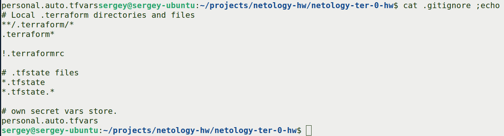

**Ответ на вопрос:** согласно этому `.gitignore`, личную и секретную информацию (логины, пароли, ключи, токены) допустимо сохранять в файле **`personal.auto.tfvars`**.

Этот файл явно перечислен в `.gitignore` — значит, он не попадёт в git-репозиторий. Terraform автоматически подхватывает любые файлы с расширением `*.auto.tfvars` и подставляет значения в переменные. Поэтому туда безопасно класть секреты, которые не должны улететь в публичный репозиторий.

### Инициализация проекта

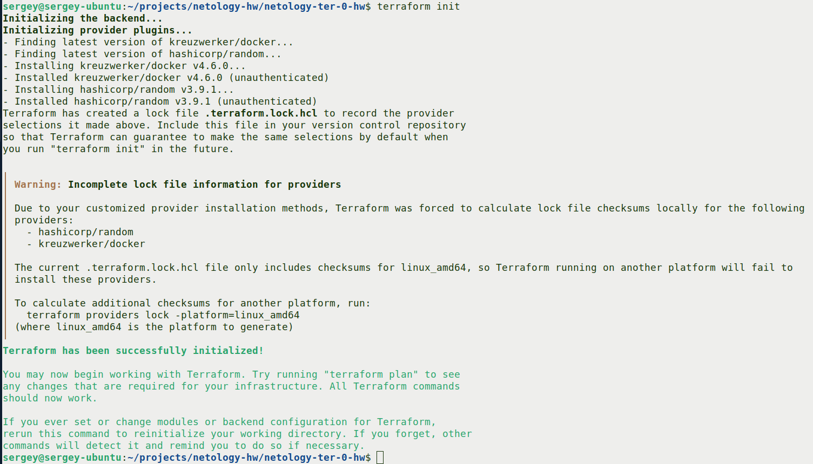

Terraform скачал провайдеры `kreuzwerker/docker` и `hashicorp/random` через зеркало Яндекса (настроено в `.terraformrc`).

### Секретное содержимое `random_password`

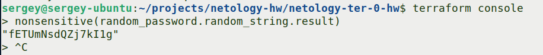

**Ответ на вопрос:**
- **Ключ:** `result`
- **Значение:** `fETUmNsdQZj7kI1g`

Значение достаётся через `terraform console` и функцию `nonsensitive()` — по умолчанию в state оно скрыто как `(sensitive value)`.

### Намеренные ошибки в `main.tf`

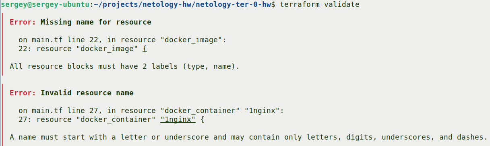

**Разбор ошибок:**

**1. `Missing name for resource` — у ресурса `docker_image` нет имени.**

В Terraform у каждого ресурса должно быть **два** лейбла: тип и имя. Было `resource "docker_image" {`, стало `resource "docker_image" "nginx" {`.

**2. `Invalid resource name` — имя `1nginx` начинается с цифры.**

Правило Terraform: имя ресурса должно начинаться с буквы или подчёркивания, содержать только буквы, цифры, подчёркивания и дефисы. Было `resource "docker_container" "1nginx" {`, стало `resource "docker_container" "nginx" {`.

**3. Скрытая ошибка в выражении (не ловится `validate`).**

Внутри блока `docker_container` была ссылка на несуществующий ресурс:

```hcl
name = "example_${random_password.random_string_FAKE.resulT}"
```

Проблемы:
- Ресурс называется `random_string`, а не `random_string_FAKE`
- Атрибут называется `result` (строчная `t`), а не `resulT`

Исправлено на:

```hcl
name = "example_${random_password.random_string.result}"
```

### Исправленный фрагмент кода

```hcl
resource "docker_image" "nginx" {
  name         = "nginx:latest"
  keep_locally = true
}

resource "docker_container" "nginx" {
  image = docker_image.nginx.image_id
  name  = "example_${random_password.random_string.result}"

  ports {
    internal = 80
    external = 9090
  }
}
```

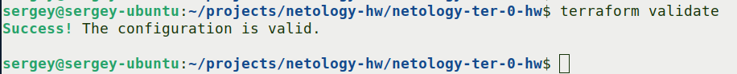

### Применение

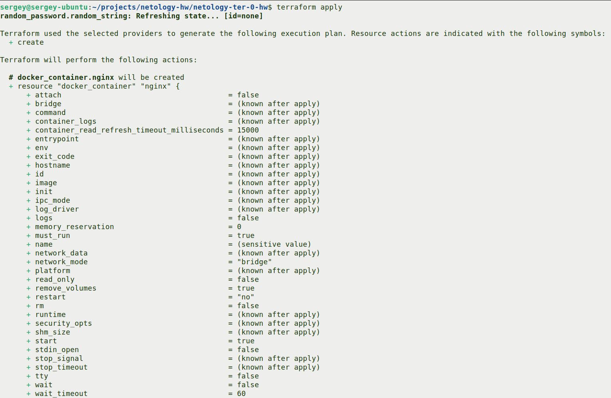
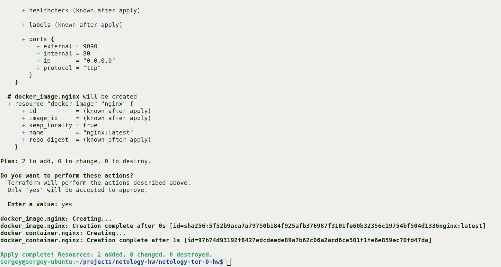

Контейнер создан, имя — `example_fETUmNsdQZj7kI1g`, образ — `nginx:latest`.

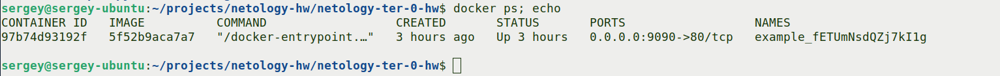

---

## Задание 2. Смена имени контейнера и опасность `-auto-approve`

### Замена имени контейнера на `hello_world`

Имя **контейнера** изменено на `hello_world`. Имя **образа** осталось `nginx:latest`:

```hcl
resource "docker_image" "nginx" {
  name         = "nginx:latest"     # имя ОБРАЗА — не меняется
  keep_locally = true
}

resource "docker_container" "nginx" {
  image = docker_image.nginx.image_id
  name  = "hello_world"              # имя КОНТЕЙНЕРА — изменилось
  ...
}
```

### Применение с `-auto-approve`

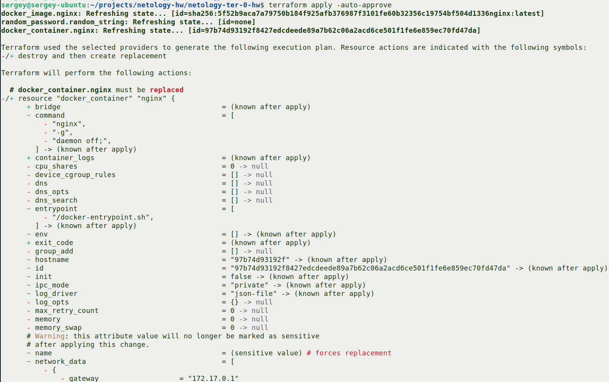
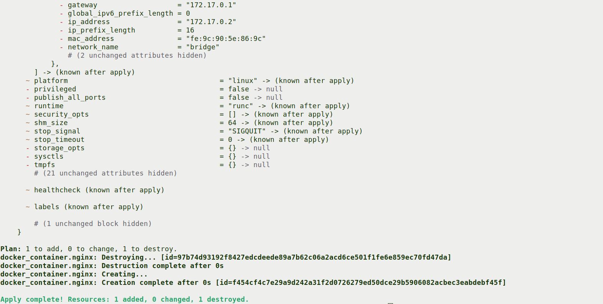

Старый контейнер `example_...` уничтожен, создан новый `hello_world`.

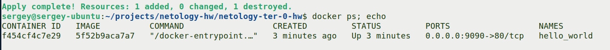

### Что делает `-auto-approve` и в чём его опасность

**Что делает:** флаг `-auto-approve` пропускает интерактивное подтверждение `Do you want to perform these actions?`. Terraform применяет план без ввода `yes` вручную.

**Опасность:** Terraform не даёт шанса **проверить план перед применением**. Если в плане есть неожиданные действия — например, пересоздание критичного ресурса или удаление базы данных, — ты не успеешь это заметить и отменить. В продакшене это может привести к сносу работающей инфраструктуры без предупреждения.

**Зачем пригодится:**
- **Автоматизация.** В CI/CD (GitHub Actions, GitLab CI) нет интерактивного терминала — невозможно ввести `yes`. Без `-auto-approve` пайплайн зависнет.
- **Тестовые окружения.** Когда ты уверен в плане и хочешь быстро развернуть/пересоздать dev-стенд без ручных подтверждений.
- **Скрипты.** Если `terraform apply` вызывается из bash-скрипта или Ansible — тоже нужен флаг.

---

## Задание 3. Уничтожение ресурсов и `keep_locally`

### Уничтожение

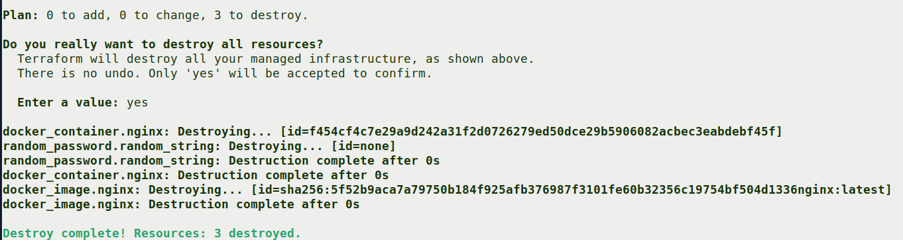

Все три ресурса удалены из управления Terraform.

### Проверка state-файла

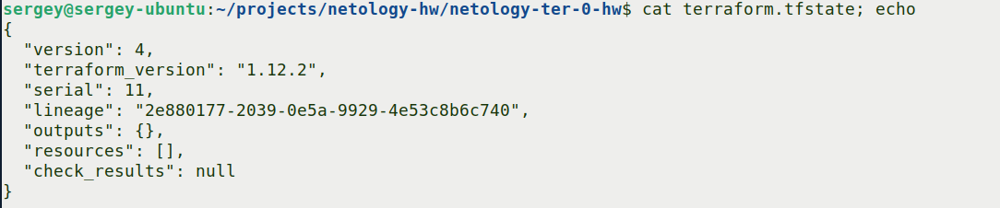

Поле `"resources": []` пустое — Terraform больше не управляет ни одним ресурсом.

### Почему образ `nginx:latest` не удалён

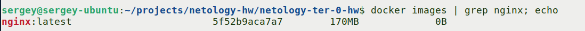

Образ не удалён, потому что в `main.tf` указан параметр `keep_locally = true`:

```hcl
resource "docker_image" "nginx" {
  name         = "nginx:latest"
  keep_locally = true
}
```

**Подтверждение из документации провайдера `kreuzwerker/docker`:**

Источник: [resource docker_image — kreuzwerker/docker](https://registry.terraform.io/providers/kreuzwerker/docker/latest/docs/resources/image)

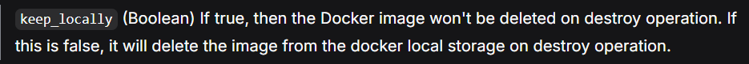

**Итого:** Terraform удаляет ресурс `docker_image.nginx` **из своего state**, но не трогает сам образ в локальном хранилище Docker, потому что `keep_locally = true`. Если бы параметр был `false` — образ был бы удалён вместе с контейнером.

---

## Автор

- **Студент**: Мешков Сергей
- **Курс**: Netology, DevOps
- **Дата выполнения**: Октябрь 2026
